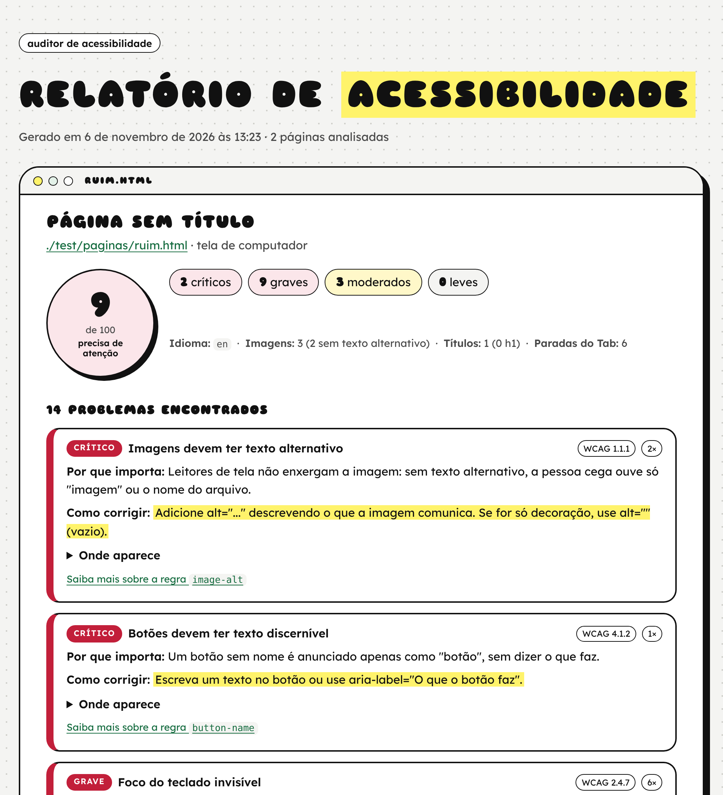
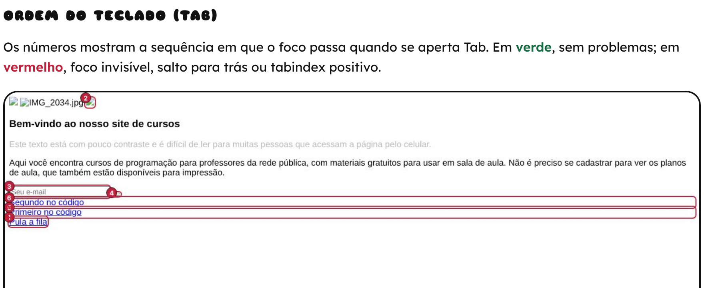

# Auditor de acessibilidade

Analisa páginas da web e gera um **relatório em português**, com explicações simples de *por que* cada problema importa e *como corrigir*. É feito para professoras, estudantes e desenvolvedores que não são especialistas em acessibilidade.



## O que ele verifica

| Tema | Como |
|---|---|
| Contraste de cores, textos alternativos, rótulos de formulário, nomes de links e botões, idioma, título da página, regiões, ARIA… | [axe-core](https://github.com/dequelabs/axe-core), regras WCAG 2.2 A/AA e boas práticas, com mensagens em português |
| **Ordem de leitura pelo teclado** | aperta Tab de verdade, página por página, e acusa saltos para trás e `tabindex` positivo |
| **Foco visível** | compara o estilo de cada elemento com e sem foco; se nada muda, o foco é invisível |
| **Estrutura de títulos** | falta de `h1`, vários `h1`, níveis pulados (h2 → h4) e um "sumário" de como o leitor de tela enxerga a página |
| **Textos alternativos pouco úteis** | `alt="imagem"`, `alt="foto"`, `alt="IMG_2034.jpg"`… |
| **Idioma trocado** | conteúdo em português com `lang="en"` (o leitor de tela pronuncia errado) |

O relatório também mostra uma captura da página com **a ordem do Tab numerada**: verde quando está tudo certo e vermelho quando há problema.



Veja um relatório completo em [`docs/exemplo/relatorio.html`](docs/exemplo/relatorio.html), gerado a partir das páginas de teste em [`test/paginas`](test/paginas).

## Como usar

É preciso ter o [Node.js](https://nodejs.org) 18 ou mais novo.

```bash
git clone https://github.com/ohtopico/auditor-acessibilidade
cd auditor-acessibilidade
npm install
npx playwright install chromium   # baixa o navegador usado na análise (uma vez só)

node bin/auditar.js ohtopico.com.br
```

O relatório fica em `relatorio-acessibilidade/relatorio.html` (para abrir no navegador ou imprimir em PDF) e `relatorio.json` (para usar em outros programas).

### Opções

```
auditar <endereço> [<endereço> ...] [opções]

  -s, --saida <pasta>     pasta do relatório (padrão: ./relatorio-acessibilidade)
  -c, --celular           simula a tela de um celular (390×844)
      --max-tab <n>       quantos elementos percorrer com Tab (padrão: 80)
      --sem-captura       não gera a imagem com a ordem do Tab
      --minimo <n>        sai com erro se algum índice ficar abaixo de n
```

Exemplos:

```bash
# várias páginas no mesmo relatório
node bin/auditar.js https://exemplo.com.br https://exemplo.com.br/contato

# como se fosse no celular
node bin/auditar.js https://exemplo.com.br --celular

# um arquivo HTML do seu computador
node bin/auditar.js meu-site/index.html
```

### No GitHub Actions

Com `--minimo`, o auditor sai com erro quando uma página fica abaixo do índice escolhido. Assim dá para barrar mudanças que pioram a acessibilidade:

```yaml
- run: npx playwright install --with-deps chromium
- run: node bin/auditar.js https://meu-site.com.br --minimo 85
```

### Como biblioteca

```js
import { auditar, gerarHtml } from './index.js';

const resultado = await auditar('https://exemplo.com.br', { tela: 'celular' });
console.log(resultado.indice, resultado.problemas.length);
```

## Sobre o índice de 0 a 100

O índice começa em 100 e perde pontos a cada regra violada: 10 para problemas críticos, 6 para graves, 3 para moderados e 1 para leves, com um pouco a mais quando o problema se repete. **É só uma referência para comparar versões da mesma página**, não uma nota oficial nem certificação.

## Limitações

- Verificações automáticas encontram por volta de **um terço** dos problemas de acessibilidade. Nada substitui navegar só com o teclado, testar com leitor de tela (NVDA, TalkBack, VoiceOver) e, principalmente, ouvir pessoas com deficiência.
- A detecção de foco invisível é uma heurística: se o foco aparece só de um jeito que o auditor não mede (por exemplo, um elemento vizinho muda), ele pode acusar um falso problema.
- Páginas que exigem login ainda não são suportadas.

## Testes

```bash
npm test
```

São testes unitários das checagens e testes de ponta a ponta com uma página cheia de problemas ([`ruim.html`](test/paginas/ruim.html)) e uma página acessível ([`boa.html`](test/paginas/boa.html)).

## Licença

MIT. As regras e traduções do axe-core são da Deque Systems (MPL-2.0).

---

Feito por **Júlia Roberta Quoos Alves** · [ohtopico.com.br](https://ohtopico.com.br)
